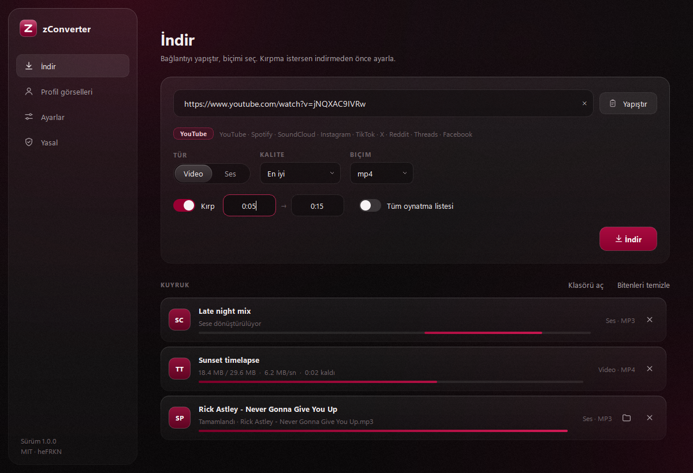
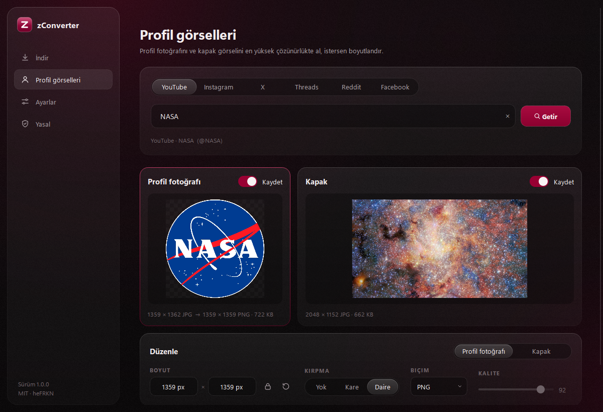

<p align="center">
  
</p>

<h1 align="center">zConverter</h1>

<p align="center">
  Video, müzik ve profil görsellerini tek yerden indir. İndirirken kırp, boyutlandır, dönüştür.<br>
  Sade bir Windows uygulaması. Hesap yok, reklam yok, telemetri yok.
</p>

<p align="center">
  <a href="LICENSE">MIT Lisansı</a> ·
  <a href="TERMS.md">Kullanım koşulları</a> ·
  <a href="PRIVACY.md">Gizlilik ve KVKK</a> ·
  <a href="#english">English</a>
</p>

<p align="center"></p>

## Özellikler

- **Video ve ses indirme:** YouTube, Spotify, SoundCloud, Instagram, TikTok, X, Reddit, Threads, Facebook
- **Biçimler:** MP4 / MKV video (360p'den 4K'ya), MP3 / M4A / OPUS / FLAC / WAV ses (128 - 320 kbps)
- **İndirirken kırpma:** başlangıç ve bitiş zamanını yaz, sadece o bölüm kaydedilsin (kare hassasiyetinde)
- **Kapak ve etiketler:** MP3 / M4A dosyalarına başlık, sanatçı, albüm ve kapak görseli otomatik eklenir
- **Oynatma listeleri:** tüm listeyi tek seferde indir
- **Profil görselleri:** YouTube, Instagram, X, Threads, Reddit ve Facebook hesaplarının profil fotoğrafı ve kapak (banner) görseli, en yüksek çözünürlükte
- **Görsel düzenleme:** piksel cinsinden boyutlandırma (oran kilidiyle), kare / daire / 16:9 kırpma, PNG / JPG / WEBP dönüştürme, kalite ayarı, canlı önizleme
- **Kuyruk:** aynı anda 1 - 4 indirme, iptal ve tekrar deneme
- Bağlantıyı pencereye sürükle bırak, ya da tek tıkla panodan yapıştır

<p align="center"></p>

## Platform desteği

| Platform | Video | Ses | Profil fotoğrafı | Kapak / banner |
|---|:---:|:---:|:---:|:---:|
| YouTube | ✓ | ✓ | ✓ | ✓ |
| Spotify | – | ✓ ¹ | – | – |
| SoundCloud | – | ✓ | – | – |
| Instagram | ✓ | ✓ | ✓ ² | platformda yok |
| TikTok | ✓ | ✓ | – | – |
| X (Twitter) | ✓ | ✓ | ✓ | ✓ |
| Reddit | ✓ | ✓ | ✓ ³ | ✓ ³ |
| Threads | ✓ ⁴ | ✓ ⁴ | ✓ | platformda yok |
| Facebook | ✓ | ✓ | ✓ | ✓ ³ |

1. Spotify DRM korumalıdır; ses Spotify'dan **indirilmez**. Parça bilgisi okunur ve aynı şarkı YouTube'da bulunur. Etiketler ve albüm kapağı Spotify'dakiyle aynı olur.
2. Oturum açmadan küçük boyut gelir. Tam çözünürlük için Ayarlar → Tarayıcı oturumu.
3. Platform anonim erişime izin vermiyor; Ayarlar → Tarayıcı oturumu gerekir.
4. Sınırlı destek: herkese açık gönderilerde çalışır.

Gizli, yaş sınırlı ya da giriş isteyen içerikler için **Ayarlar → Tarayıcı oturumu** ile giriş yaptığın tarayıcıyı seçebilirsin. Çerezler bilgisayarından dışarı çıkmaz. Ayrıntılar: [PRIVACY.md](PRIVACY.md).

## Kurulum

1. [Releases](https://github.com/heFRKN/zConverter/releases) sayfasından `zConverter-x.y.z-windows-x64.zip` dosyasını indir.
2. Zip'i bir klasöre çıkar ve `zConverter.exe`'yi çalıştır.
3. Windows SmartScreen "tanınmayan uygulama" uyarısı verirse: **Ek bilgi → Yine de çalıştır**. (Uygulama imzasız olduğu için bu uyarı normaldir; kaynak kodun tamamı bu depoda.)

**İsteğe bağlı:** YouTube'un tüm kalite seçenekleri için bir JavaScript çalışma ortamı önerilir:

```powershell
winget install DenoLand.Deno
```

FFmpeg uygulamanın içinde gelir, ayrıca kurman gerekmez.

## Kaynaktan çalıştırma ve derleme

Python 3.12+ gerekir.

```powershell
git clone https://github.com/heFRKN/zConverter.git
cd zConverter
python -m venv .venv
.venv\Scripts\pip install -r requirements.txt
.venv\Scripts\python run.py
```

Exe ve dağıtım zip'i üretmek için:

```powershell
powershell -ExecutionPolicy Bypass -File build.ps1
```

Çıktı: `dist\zConverter\zConverter.exe` ve `dist\zConverter-x.y.z-windows-x64.zip`.

## Proje yapısı

```
zconverter/
  core/        indirme motoru, Spotify eşleştirme, profil görselleri, medya işleme (arayüzden bağımsız)
  ui/          PySide6 arayüzü: tema, bileşenler, sayfalar
tools/         ikon üretici, ekran görüntüsü aracı
```

## Yasal

zConverter yalnızca **hakkın olan ya da kişisel kullanımına izin verilen** içerikler içindir. İndirdiğin içerikten ve onu nasıl kullandığından sen sorumlusun; telif hakkı mevzuatı (FSEK, DMCA vb.), KVKK ve platformların hizmet koşulları geçerlidir. Uygulama DRM'yi aşmaz, hiçbir içerik barındırmaz, platformlara kendini dürüstçe tanıtır ve hiçbir veri toplamaz.

- [Kullanım koşulları ve yasal uyarı](TERMS.md)
- [Gizlilik politikası ve KVKK aydınlatma metni](PRIVACY.md)
- [Üçüncü taraf lisansları](THIRD_PARTY_NOTICES.md)

YouTube, Spotify, SoundCloud, Instagram, TikTok, X, Reddit, Threads ve Facebook sahiplerinin ticari markalarıdır. zConverter bunların hiçbiriyle bağlantılı değildir, onlar tarafından desteklenmez veya onaylanmaz.

## Lisans

[MIT](LICENSE) © 2026 heFRKN. Derlenmiş sürümlerdeki üçüncü taraf bileşenler (FFmpeg: GPL-3.0, Qt: LGPL-3.0 vb.) kendi lisanslarına tabidir.

---

<a id="english"></a>

## English

**zConverter** is a simple Windows app to download video and audio from YouTube, Spotify, SoundCloud, Instagram, TikTok, X, Reddit, Threads and Facebook, and to grab profile pictures and banners from YouTube, Instagram, X, Threads, Reddit and Facebook. You can trim audio/video and resize, crop or convert images right before saving.

- MP4 / MKV video up to 4K, MP3 / M4A / OPUS / FLAC / WAV audio with tags and cover art
- Frame-accurate trimming while downloading
- Profile images at full resolution with resize, square/circle/16:9 crop and PNG/JPG/WEBP export
- Spotify: no audio is ever downloaded from Spotify (DRM); public track metadata is read and the song is matched on YouTube
- No accounts, no telemetry, no servers. The app identifies itself honestly and never circumvents DRM or bot protection

**Install:** download the zip from [Releases](https://github.com/heFRKN/zConverter/releases), extract, run `zConverter.exe`. **Build:** `powershell -ExecutionPolicy Bypass -File build.ps1`.

**Legal:** for content you own or are allowed to save for personal use only. You are responsible for complying with copyright law and each platform's terms. See [TERMS.md](TERMS.md), [PRIVACY.md](PRIVACY.md) and [THIRD_PARTY_NOTICES.md](THIRD_PARTY_NOTICES.md). Not affiliated with any of the platforms named above.

**License:** [MIT](LICENSE) © 2026 heFRKN.
